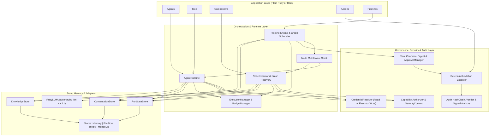

# HeuristicSyndicate (`heuristic_syndicate`)

**A Ruby Framework for Governed, Durable and Observable AI Workflows.**

`heuristic_syndicate` extends [`ruby_llm`](https://github.com/crmne/ruby_llm) (`~> 2.1`) with Haystack-inspired graph orchestration, at-least-once durable execution, capability-based security, multi-tenancy, versioned action contracts, human-in-the-loop (HITL) interrupts, and tamper-evident auditing. It runs in both Plain Ruby (`>= 3.4.5`) and Ruby on Rails (`8.1+`).

---

## Core Pillars

1. **Graph Orchestration:** Declarative, ActiveRecord-inspired DSL for multi-agent pipelines (`node`, `connect`, conditional routing, bounded loops with `max_visits`, and parallel fan-out/fan-in waves).
2. **Durable Execution & Crash Recovery:** At-least-once node execution backed by atomic claims, expiring leases, monotonically increasing fencing tokens, transactional outbox publishing, and explicit side-effect reconciliation (`:idempotent`, `:reconcile`, `:manual_review`, `:non_retryable`).
3. **Decoupled State & Checkpoints:** Strict separation between `Pipeline Runtime` checkpoints (`RunStateStore`) and `Conversation Runtime` checkpoints (`ConversationStore` + `ConversationCheckpoint` schema v1), enabling cross-process pause and resume without serializing live Ruby objects or credentials.
4. **Capability-Based Security & Multi-Tenancy:** Four-layer capability authorization (`permits`, `capabilities`, `requires_capability`, resource patterns, and immutable `SecurityContext`), mandatory `tenant_id` isolation across all stores, SSRF egress protection, and structured untrusted tool output classification (`UntrustedData`) with automatic secret redaction.
5. **Deterministic Governance & Tamper-Evident Auditing:** LLMs analyze and propose; only the deterministic `Governance::Executor` performs state-mutating `Action`s after verifying canonical SHA-256 plan digests, four-eyes `ApprovalPolicy` rules, action version parity, preconditions, and post-apply verifications (with automatic compensation on failure). Every event is recorded in an append-only SHA-256 hash chain anchored by HMAC-signed external integrity checkpoints.
6. **Offline Testability:** Ships with `HeuristicSyndicate::Testing::FakeProvider`, `CrashInjector` (supporting real OS subprocess crash injection via `Process.fork`), and Minitest assertions so complex multi-agent workflows run deterministically without network access or live API keys.

---

## Architecture Overview



---

## Requirements & Installation

- **Ruby:** `>= 3.4.5`
- **Runtime Dependency:** `ruby_llm ~> 2.1` (zero additional runtime gems in core)

Add to your `Gemfile`:

```ruby
gem "heuristic_syndicate"
```

Or build and install locally from this repository:

```bash
bundle install
bundle exec rake test
```

---

## Quickstart & Core API

### 1. Define a Capability-Scoped Tool

```ruby
class WorkspaceStatusTool < HeuristicSyndicate::Tool
  description "Read KASM workspace status"

  read_only
  requires_capability :workspace_read
  scope "kasm"
  inject :kasm_reader

  untrusted_output
  max_output 8_000

  def execute(workspace_id:)
    kasm_reader.status(workspace_id)
  end
end
```

### 2. Define a Declarative Agent (Composition over Inheritance)

```ruby
class KasmAgent < HeuristicSyndicate::Agent
  goal "Inspect KASM workspaces"
  model "claude-sonnet-4-5"

  permits :read
  scope "kasm"

  capabilities do
    allow :workspace_read, resources: ["production.*"]
  end

  tools WorkspaceStatusTool
  outputs :kasm_analysis
  stops_when max_turns: 6
end
```

### 3. Define a Deterministic Component

```ruby
class TimelineBuilder < HeuristicSyndicate::Component
  input :events, type: Array
  output :timeline, type: Array

  def call(events:, **_rest)
    { timeline: events.sort_by { |e| e[:timestamp].to_s } }
  end
end
```

### 4. Define a Versioned Action Contract

```ruby
class RestartWorkspaceAction < HeuristicSyndicate::Action
  action_name "kasm_restart_workspace"
  version "1.0.0"
  risk :medium
  idempotent true
  recovery_strategy :reconcile
  requires_capability :workspace_restart

  params do
    required :workspace_id, :string
  end

  def precondition(context, params)
    writer(context).workspace_exists?(params[:workspace_id])
  end

  def apply(context, params, idempotency_key: nil)
    writer(context).restart_workspace!(params[:workspace_id], idempotency_key: idempotency_key)
  end

  def verify(context, params)
    writer(context).workspace_healthy?(params[:workspace_id])
  end

  def reconcile(context, params, idempotency_key: nil)
    writer(context).query_restart_status(params[:workspace_id], idempotency_key: idempotency_key)
  end

  def compensate(context, params)
    writer(context).restore_snapshot!(params[:workspace_id])
  end

  private

  def writer(context)
    context[:credential_resolver].resolve(:kasm_writer, security_context: context[:security_context])
  end
end
```

### 5. Assemble & Run a Governed Pipeline with Durable Interrupts

```ruby
class IncidentPipeline < HeuristicSyndicate::Pipeline
  node :kasm, KasmAgent
  node :planner, PlannerAgent
  node :plan_compiler, PlanCompilerComponent
  node :approval, HeuristicSyndicate::Interrupt, type: :approval
  node :executor, IncidentExecutorComponent

  connect "kasm.kasm_analysis", "planner.findings"
  connect "planner.raw_plan", "plan_compiler.raw_plan"
  connect "plan_compiler.plan", "approval.resource"
  connect "plan_compiler.plan", "executor.plan"
  connect "approval.decision", "executor.decision"

  validate!
end

# 1. Execute until human approval interrupt suspends the run
security_context = HeuristicSyndicate::SecurityContext.new(
  tenant_id: "acme_prod",
  actor_id: "oncall_trigger",
  capabilities: [{ name: :workspace_read, resources: ["production.*"] }]
)

suspended_run = IncidentPipeline.run({ incident_id: "inc_42" }, security_context: security_context)
# => suspended_run.status == :suspended

# 2. Record digest-bound human approval and resume (e.g., in a background job after process restart)
completed_run = IncidentPipeline.resume(
  run_id: suspended_run.id,
  decision: { approved: true, approver_id: "admin_anna", digest: plan.digest },
  security_context: security_context
)
# => completed_run.status == :completed
```

---

## Flagship Reference Workflow: AI Sysadmin Agent (Werkbank)

See [`examples/werkbank/incident_workflow.rb`](./examples/werkbank/incident_workflow.rb) and [`test/werkbank_workflow_test.rb`](./test/werkbank_workflow_test.rb) for a complete, offline-runnable implementation of the **Werkbank** IT infrastructure incident workflow across **KASM**, **PostgreSQL**, **GitLab**, and **VMware vSphere**:

1. **Parallel Read-Only Analysis:** Four specialist agents (`KasmAgent`, `PostgresAgent`, `GitlabAgent`, `VsphereAgent`) inspect their respective systems concurrently using read-only capabilities.
2. **Deterministic Timeline & Correlation:** `TimelineBuilder` merges evidence chronologically; `CorrelationAgent` proposes hypotheses with mandatory `evidence_refs`.
3. **Evidence Validation Loop:** `EvidenceValidationComponent` rejects fabricated references and loops back to specialist analysis (`max_visits: 2`) when `needs_more_data` is true.
4. **Allowlisted Planning & Canonical Digest:** `PlannerAgent` and `PlanCompilerComponent` produce a `Governance::Plan` validated against `ActionRegistry` with a SHA-256 approval digest.
5. **Durable Approval Interrupt:** Execution suspends and checkpoints state until an administrator approves the exact plan digest.
6. **Deterministic Execution & Audit Anchoring:** `Governance::Executor` switches to `:executor` mode, resolves write credentials, rechecks preconditions, applies actions idempotently, verifies target health, and writes a signed external audit anchor before `ReportAgent` generates the final incident report.

---

## Testing & Verification

Run the complete Minitest suite (35 tests, 178 assertions, zero network calls):

```bash
rake test
```

| Test File | Coverage |
| :--- | :--- |
| [`test/spike_1_adapter_test.rb`](./test/spike_1_adapter_test.rb) | `LLM-01..LLM-12`: `RubyLLMAdapter`, tool call interception, error normalization, approval pauses, and real `Process.fork` subprocess conversation restore. |
| [`test/spike_2_recovery_test.rb`](./test/spike_2_recovery_test.rb) | `REC-01..REC-12`: Atomic claims, lease expiration, fencing token rejection (`LeaseLostError`), real subprocess crash injection (`exit!(137)`), side-effect reconciliation, outbox delivery, and tenant isolation. |
| [`test/end_to_end_recovery_test.rb`](./test/end_to_end_recovery_test.rb) | Integrated Spike 1 + Spike 2 multi-process crash recovery of an active LLM conversation, open tool call, external side effect, and workflow node execution. |
| [`test/security_and_governance_test.rb`](./test/security_and_governance_test.rb) | Capability enforcement, resource scoping, SSRF protection, `UntrustedData` secret redaction, four-eyes approval policy, action version drift, compensation, and audit hash-chain tamper detection. |
| [`test/werkbank_workflow_test.rb`](./test/werkbank_workflow_test.rb) | End-to-end offline execution of `Werkbank::IncidentPipeline` including evidence loop-back (`max_visits: 2`), durable suspend/resume, and audit verification. |

---

## Architecture & Design Documents

| Document | Description |
| :--- | :--- |
| [**Architecture Decision Record (ADR 2.1)**](./architecture_decision_record.md) | Authoritative specification of ADRs 001–013, layered architecture, security boundaries, governance contracts, and roadmap. |
| [**Spike 1 & Spike 2 Specification**](./spike1_spike2.md) | Design and test matrices (`LLM-01..12`, `REC-01..12`, and §5 E2E integration) for the `RubyLLMAdapter` and Crash Recovery prototypes. |
| [**Spike 1 & Spike 2 Results**](./docs/spike-results.md) | Empirical findings from `ruby_llm` 2.1 verification, test matrix outcomes, and final answers to the 6 architectural questions. |
| [**AI Sysadmin Agent (Werkbank) Use Case**](./use_case_werkbank.md) | Business and operational specification for cross-system incident analysis and approval-gated remediation. |
| [**Hybrid RAG & Blueprint Notes**](./hybrid_rag.md) | Initial exploration notes on RubyLLM, MongoDB `$rankFusion`, Docling, and sysadmin agent patterns. |

---

## Repository Structure

```text
.
├── Gemfile
├── LICENSE
├── README.md
├── Rakefile
├── architecture_decision_record.md
├── spike1_spike2.md
├── use_case_werkbank.md
├── hybrid_rag.md
├── heuristic_syndicate.gemspec
├── docs/
│   └── spike-results.md
├── drafts/
│   ├── phase1_analysis.md
│   └── phase2_design.md
├── examples/
│   └── werkbank/
│       └── incident_workflow.rb
├── lib/
│   ├── heuristic_syndicate.rb
│   └── heuristic_syndicate/
│       ├── adapters/mongo/store.rb
│       ├── audit/{checkpoint,event,hash_chain}.rb
│       ├── configuration.rb
│       ├── definitions/{action,agent,component,pipeline,tool}.rb
│       ├── errors.rb
│       ├── execution/{checkpoint,execution_event,execution_lease,fencing_token,idempotency,node_execution,run}.rb
│       ├── governance/{action_registry,approval,executor,plan}.rb
│       ├── instrumentation/bus.rb
│       ├── interrupts/interrupt.rb
│       ├── llm/{adapter,conversation_checkpoint,ruby_llm_adapter}.rb
│       ├── memory/stores.rb
│       ├── middleware/stack.rb
│       ├── pipeline/graph.rb
│       ├── rails/railtie.rb
│       ├── runtime/{agent_runtime,budget_manager,execution_manager,node_executor}.rb
│       ├── security/{authorizer,capability,credential_resolver,security_context,untrusted_data}.rb
│       ├── store/{capabilities,file,memory}.rb
│       ├── testing/{assertions,crash_injector,fake_provider}.rb
│       └── version.rb
└── test/
    ├── end_to_end_recovery_test.rb
    ├── security_and_governance_test.rb
    ├── spike_1_adapter_test.rb
    ├── spike_2_recovery_test.rb
    ├── test_helper.rb
    └── werkbank_workflow_test.rb
```

---

## License

This project is licensed under the [MIT License](./LICENSE).
