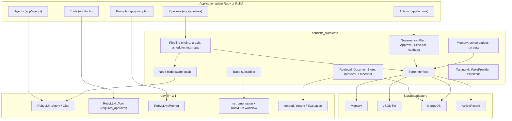
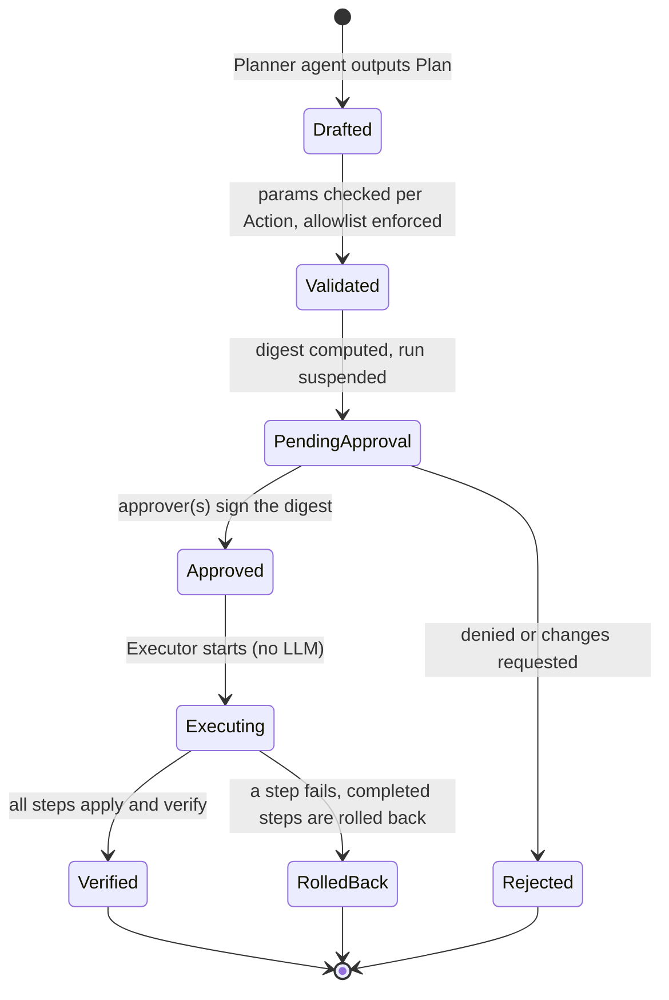
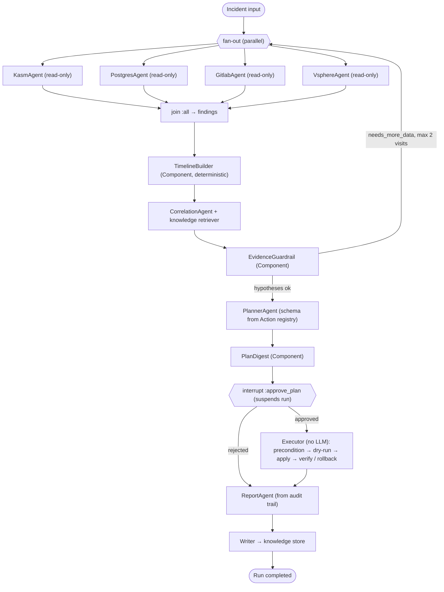

# Phase 2: Framework Design for `heuristic_syndicate`

> **Status:** draft for review. No code yet. The gem skeleton follows once this design is approved.
> **Builds on:** [phase1_analysis.md](./phase1_analysis.md)

## 0. Decisions so far

| Topic | Decision |
|---|---|
| Gem / namespace | `heuristic_syndicate` / `HeuristicSyndicate` |
| Ruby | `>= 3.4.5` (also runs on 4.0.x) |
| ruby_llm | `~> 2.1` (subclass and extend, never fork or duplicate) |
| Rails | Optional. A plain-Ruby core plus a Railtie that activates only when Rails (8.1+) is loaded |
| Runtime dependencies | Core: `ruby_llm` + stdlib only. Optional adapters: `mongo ~> 2.26`, `async ~> 2.46`, `activerecord`/`activejob` |
| Storage | Memory (test), JSON file (development), **MongoDB (first-class)**, ActiveRecord |
| Orchestration | Haystack-style `Pipeline` graph. A RubyLLM agent loop can run as a node |
| Human approval (HITL) | Durable: the run is saved and suspended, then resumed later by a job |
| Governance | Built in, opt-in: tool access levels, `Action`, `Plan`, `Approval`, `Executor`, `AuditLog` |
| Prompts | ruby_llm's convention: `app/prompts/<agent_name>/instructions.txt.erb` |
| Parallelism | Threads in the core, `async` (fibers) as an adapter |
| Tests | Minitest plus a built-in fake LLM provider |
| Docs language | English |

---

## 1. Architecture overview

The framework adds three layers to ruby_llm: **orchestration**, **state** and **governance**. Everything that ruby_llm already does well stays in ruby_llm: model calls, the tool loop, per-tool approval, fallbacks, prompt rendering and instrumentation.



### Request lifecycle (one pipeline run)

1. `Pipeline.run(inputs, context:)` creates a **Run** (id, status, state, injected dependencies, budget) and opens a `RubyLLM.workflow` span.
2. The **scheduler** finds the nodes that are ready to run (all required inputs present). Nodes that are ready at the same time run in parallel through the configured executor strategy (threads or fibers).
3. Every node call goes through the **middleware stack** (tracing, audit, budget, timeout, retry, cache, redaction, guardrails), then reaches the node's `call`.
4. Agent nodes build a RubyLLM chat from their `HeuristicSyndicate::Agent` class and run ruby_llm's own tool loop.
5. When a node needs a human (an `interrupt` node, or a RubyLLM tool call that requires approval), the engine **checkpoints** the run to the store and returns a `suspended` Run.
6. A job, or a direct call, **resumes** the run with the human's decision. The scheduler continues from the checkpoint.
7. Governance nodes (`Executor`) apply approved plans deterministically, with no LLM involved, and write every step to the `AuditLog`.

---

## 2. Rails principles applied to agents

### 2.1 Convention over configuration

| Concern | Convention (zero config) | Override |
|---|---|---|
| File locations | `app/agents`, `app/tools`, `app/pipelines`, `app/actions`, `app/components`, `app/prompts` | Autoload paths in config |
| Naming | `KasmAgent` → `app/agents/kasm_agent.rb` → prompt `app/prompts/kasm_agent/instructions.txt.erb` | Explicit `instructions` string or block |
| Model | `HeuristicSyndicate.config.default_model`, falling back to ruby_llm's default | `model` macro per agent |
| Store | Memory in `test`, JSON file in `development`, configured adapter in `production` | `config.store = ...` or per pipeline |
| Middleware | Default stack: Instrumentation → Audit → Budget → Timeout → Guardrails | `use`, `insert_before`, `delete`, `swap` |
| Tool access | Undeclared tools are treated as **write** (safe default) | `read_only` macro on the tool |
| Parallelism | `:threads` | `config.concurrency = :async` |
| Run IDs, step IDs | Generated UUIDs, shared with RubyLLM workflow events | Pass `id:` explicitly |

### 2.2 MVC mapping

| Layer | Framework parts | Responsibility |
|---|---|---|
| **Model** | `Agent`, `Tool`, `Action`, `Document`, `Plan`, `Run`, `Approval` | Definitions and state. Introspectable, persistable, validated |
| **View** | ERB prompts (`app/prompts`), output schemas, `Presenter`s | What the LLM sees (prompts, tool output formatting, untrusted-data wrapping) and what humans see (approval summaries, reports) |
| **Controller** | `Pipeline`, `Executor`, interrupt/resume handling | Control flow, routing, retries, parallelism and suspension. Holds no domain knowledge |

**Presenters** are the "view" for data going back into an LLM. They format tool results, mark untrusted content with delimiters, and cut it to size limits. This keeps the formatting out of tools and agents.

### 2.3 DRY through concerns

Shared behaviour lives in modules that agents, tools and components include:

| Concern | Included in | Adds |
|---|---|---|
| `Scoped` | Agent | Declares allowed tool access levels and scopes. Refuses incompatible tools when the class loads |
| `Delegating` | Agent | `delegates_to OtherAgent`: wraps a sub-agent as a tool (agent-as-tool), with depth and budget limits |
| `Memorable` | Agent | Loads and saves the conversation through the store, keyed by a thread/conversation id |
| `Retrieving` | Agent | `retrieves_from :knowledge_base`: adds a search tool backed by a configured `Retriever` |
| `Traceable` | Agent, Tool, Component | Adds framework attributes (run id, node, scope) to RubyLLM instrumentation events |
| `Audited` | Tool, Action, Component | Writes invocation records to the `AuditLog` |
| `Injectable` | Tool, Component, Action | `inject :pg_reader`: resolves dependencies from the run context instead of constructor arguments (like Pydantic AI's `RunContext` deps) |
| `Untrusted` | Tool | Marks the output as external data. The presenter wraps it, and a rule is added to the agent's instructions |

### 2.4 ActiveRecord-style ergonomics

- **Declarative class macros** for everything: `model`, `instructions`, `tools`, `read_only`, `inject`, `node`, `connect`, `route`, `join`, `interrupt`, `risk`, `precondition`, `rollback`.
- **Introspection:** `Pipeline.nodes`, `Pipeline.edges`, `Pipeline.to_mermaid`, `Pipeline.validate!`, `Agent.tools`, `Agent.scopes`, `Tool.access`, `Action.registry`, `Action.allowlist`.
- **Queryable runs** through the store: find runs by status (for example all suspended runs), find a run's audit trail, and verify the audit chain.
- **Chainable runtime overrides**, following ruby_llm's `with_*` style: override the store, middleware or dependencies for one run without changing the class.
- **Validation when the app boots:** pipelines check their graph (unknown nodes, unconnected required inputs, cycles without a visit limit) and agents check tool scopes when classes load, not at run time.

### 2.5 Rack-style middleware

- One interface: a middleware is built with the next app plus options, receives a **NodeCall** env (node, inputs, run context, metadata), and must call the next app or short-circuit.
- Stacks can be defined **globally**, **per pipeline** and **per node**. They compose in that order.
- The scope is deliberate. Middleware wraps **pipeline nodes**. LLM-level concerns (model fallback, request hooks, tool hooks) stay with ruby_llm's `fallbacks` and `before_*`/`after_*` hooks, which the framework configures but does not reimplement.

| Built-in middleware | Purpose |
|---|---|
| `Instrumentation` | Wraps each node in a `RubyLLM.workflow` step, so ruby_llm and OpenTelemetry traces show the graph structure |
| `Audit` | Writes node start/finish/failure to the `AuditLog` (opt-in per node or pipeline) |
| `Budget` | Limits tokens, cost, tool calls and wall time per run, using ruby_llm's `tokens` / `cost` |
| `Timeout` | Time limit per node |
| `Retry` | Node-level retries with backoff (separate from model fallback) |
| `Cache` | Caches node results, keyed by a digest of node name, version and inputs, in the store |
| `Redaction` | Removes secrets and personal data from inputs before they reach LLM nodes |
| `Guardrail` | Validates outputs: schema checks and evidence-reference checks (every hypothesis must cite known evidence) |

---

## 3. Core building blocks

### 3.1 `HeuristicSyndicate::Agent` (subclass of `RubyLLM::Agent`)

Inherits all ruby_llm macros: `model`, `instructions`, `tools`, `schema`, `inputs`, `fallbacks`, `rescue_from`, `thinking`, `mcp` and others. Adds:

| Addition | Meaning |
|---|---|
| `goal` | A short statement of purpose. It is included in the instructions and used by delegation and tracing |
| `permits :read` / `permits :read, :write` | Allowed tool access levels (`Scoped`). The default is `:read` only |
| `scope "postgres"` | Limits the agent to tools tagged with matching scopes |
| `delegates_to` | Registers sub-agents as tools, with `max_depth` and a share of the parent's budget |
| `stops_when` | Stop conditions on top of ruby_llm's loop: maximum turns, maximum tool calls, a predicate on the schema output, or a budget being exhausted |
| `outputs` | Alias for `schema` that also defines the node's output for pipelines |
| Node adapter | Any agent class can be a pipeline node. Inputs map to ruby_llm `inputs`, plus the prompt. The output is the schema hash or the content |

**Goal for developer ergonomics:** a working agent is a class with 3–5 macro lines. The full Werkbank specialist agent stays under 20 lines.

### 3.2 `HeuristicSyndicate::Tool` (subclass of `RubyLLM::Tool`)

Inherits `description`, `parameter(s)`, `execute`, `requires_approval` and `progress`. Adds:

| Addition | Meaning |
|---|---|
| `read_only` / `writes` | Access level. Undeclared tools are treated as `writes` |
| `scope "postgres"` | Tags used to match agents' scopes |
| `inject :pg_reader` | Dependency taken from the run context (no constructor injection needed) |
| `untrusted_output` | The output is external data and is wrapped by the `Untrusted` presenter |
| `max_output` | Output size limit (characters or tokens), applied by the presenter |
| Schema generation | Delegated entirely to ruby_llm (parameters inferred from `execute`, or declared) |

**Permission model, three layers:**
1. **When classes load:** an agent that does not permit `:write` cannot be given a write tool.
2. **When a tool is called:** write tools automatically get ruby_llm's `requires_approval` unless a policy explicitly exempts them.
3. **Credentials:** injected dependencies are resolved per run context. Analysis runs receive only read-only clients. Write clients exist only in the `Executor`'s context.

### 3.3 `Component` (pipeline node)

- A plain Ruby class with declared **inputs** (name, optional type, required/optional, default) and **outputs**, plus a single `call` method that returns a hash of outputs.
- Any callable (lambda or method object) can be wrapped as a component for quick deterministic steps.
- Deterministic work (timeline building, digests, validation, formatting) is always a Component, never an LLM.

### 3.4 `Pipeline` (orchestrator)

| Feature | Design |
|---|---|
| Graph definition | Class-level `node` (name + component/agent/pipeline class + options) and `connect` (output socket → input socket). Haystack's dotted socket names are kept |
| Scheduling | A node runs when all its required inputs are present (Haystack semantics). Nodes that are ready together run in parallel |
| Branching | `route` defines a router node with ordered conditions (predicate → output edge), like Haystack's `ConditionalRouter` |
| Fan-in | `join` with strategies: `:all` (wait for every branch), `:first`, `:merge` (combine hashes or arrays), `:custom` |
| Loops | Allowed only with `max_visits` per node. Exceeding it fails the run with a clear error |
| Nesting | A pipeline class can be a node in another pipeline (like Haystack's `SuperComponent`) |
| Interrupts | `interrupt :approve_plan` defines a node that suspends the run until resumed with a decision. Approval inside an agent (RubyLLM `requires_approval`) also suspends the run |
| Results | Returns a `Run` value: status (`completed`, `suspended`, `failed`), outputs, pending interrupt, trace id |
| Resume | Resume a run by id with a decision. Resuming is idempotent: a decision already applied is ignored |
| Visualisation | `to_mermaid` for docs and approval UIs |

**Durable checkpoints.** A checkpoint contains the scheduler state (completed nodes, pending inputs, visit counts), node outputs, run state and injected dependency *names* (never the dependencies themselves), budget used so far, and for suspended agent nodes the serialized chat (`Message#to_h` for each message, plus pending tool calls). On resume, the chat is rebuilt from the agent class and those messages, the approval decisions are applied with ruby_llm's `approve`/`deny`, and `complete` continues the loop.

> [!WARNING]
> Rebuilding a ruby_llm chat that is waiting for approval from serialized messages, outside ActiveRecord, is the main technical risk. It needs a spike before the skeleton is finished (see §9).

### 3.5 Memory and retrieval

| Kind | Design | Backed by |
|---|---|---|
| **Run state** (working memory) | A key/value "blackboard" scoped to one run, saved in checkpoints | Store |
| **Conversation memory** (short-term) | `Memorable` saves and loads chat messages by conversation id, with optional compaction (ruby_llm `compaction`) | Store; the ActiveRecord adapter reuses ruby_llm's `acts_as_chat` |
| **Knowledge** (long-term) | `DocumentStore` + `Retriever` interfaces | Memory adapter, Mongo adapter |

**Retrieval interfaces:**
- `Document`: id, content, metadata, embedding, score.
- `DocumentStore`: write, delete, count, filter by metadata.
- `Retriever`: retrieve by query with `top_k` and filters. Built-in strategies: `vector`, `keyword`, `hybrid`.
- `Embedder` wraps `RubyLLM.embed`, with batching. `Reranker` wraps `RubyLLM.rerank`.
- **Mongo adapter:** `$vectorSearch`, `$search` and hybrid search with `$rankFusion` (MongoDB 8.0+), with configurable weights and filters. It ships helpers that create the indexes. This replaces `HybridRetriever` from `hybrid_rag.md`.
- **Memory adapter:** cosine similarity plus naive keyword scoring, for tests and small corpora.
- **Ingestion** is just a pipeline: Converter → Splitter (markdown headings) → Embedder → Writer. A `docling-serve` converter adapter can use Faraday, which ruby_llm already depends on, so there is no new dependency.

### 3.6 Governance



| Building block | Design |
|---|---|
| `Action` | A deterministic handler class: a params schema, `risk` level, and `precondition`, `dry_run`, `apply`, `verify`, `rollback` hooks. It receives write credentials only through the Executor's context. `Action.allowlist` comes automatically from registered classes |
| `Plan` | A value object: title, rationale, steps (action name, params, risk, rollback and verification descriptions), and a test strategy. `Plan.schema` is **generated from the Action registry**, so the planner agent's output schema always matches the allowlist (DRY) |
| Digest | SHA-256 of canonical JSON (sorted keys, normalised values). Any change makes existing approvals invalid |
| `Approval` | Tied to (plan id, digest). A policy sets how many approvers are needed per risk level (for example two for `high`) and who may approve. The approver identity comes from the host app |
| `Executor` | For each step: precondition → dry-run → apply → verify, writing each to the audit log. On failure it rolls back the completed steps in reverse order and audits that too. It refuses to run without a valid approval for the current digest |
| `AuditLog` | Append-only, hash-chained events: sequence number, timestamp, run, actor, type, payload, previous hash, hash. Verifying the chain is part of the API. The Mongo adapter adds a unique index on the sequence number and recommends an insert-only database role |

**Audit vs. trace:** a *trace* is for debugging and observability. It may be sampled, changed or deleted. The *audit log* is a compliance record: append-only, verifiable and never sampled.

### 3.7 Trace and observability

- A **trace subscriber** registers with ruby_llm's instrumentation (the subscriber chain). It records spans for pipelines, nodes, chats, requests, tool calls, embeddings and reranks, enriched with framework context (run id, node, agent, scope, decision).
- Traces can be written to the store (to view a run's timeline) or to the logger. OpenTelemetry export comes from ruby_llm's existing integration.
- **Decision points** (router choice, join result, interrupt, approval, rollback) are emitted as dedicated framework events, so a run can be reconstructed and replayed.

### 3.8 Storage

A single `Store` interface with sub-stores: `runs`, `checkpoints`, `conversations`, `approvals`, `audit_events`, `cache`, `traces`.

| Adapter | Use | Notes |
|---|---|---|
| Memory | Tests | Thread-safe and fast. Data is lost when the process exits |
| JSON file | Development, demos | One file per run, plus an append-only JSONL audit file with file locking. Single process only |
| **MongoDB** | Production (first-class) | Collections per sub-store, index helpers, unique index on the audit sequence, and a TTL index for cache and traces. The same adapter powers the `DocumentStore` |
| ActiveRecord | Rails production | Migrations come from a generator. Conversations reuse ruby_llm's `acts_as_chat` / `acts_as_message` |

### 3.9 Testing kit

- **`FakeProvider`** registers with ruby_llm as a provider and returns scripted replies: plain text, tool calls, schema-shaped hashes, errors and token usage. Scripts are matched by agent, message pattern or call order. No network is needed.
- **Fake dependencies:** the run context accepts stand-in clients, which is how the Werkbank example stubs KASM, PostgreSQL, GitLab and vSphere.
- **Minitest assertions:** a node ran or was skipped, the run is suspended at an interrupt, a tool was called with given arguments, the plan has an expected digest, the audit chain is valid, and the run stayed within budget.
- **Quality evaluation** uses ruby_llm's `Evaluation` (with its Minitest integration). The framework adds a **replay harness**: past incidents with known root causes become evaluation cases.

---

## 4. Mapping to the ruby_llm 2.1 API

| Framework component | ruby_llm API used | Adapter needed? |
|---|---|---|
| `Agent` | Subclass of `RubyLLM::Agent`; `chat`, `ask`, `complete`, macros | No. Extended through concerns |
| Agent prompts | `RubyLLM::Prompt` + `Prompt.roots` (engine directories) | No |
| `Tool` | Subclass of `RubyLLM::Tool`, `requires_approval` | No |
| Agent-as-tool (`delegates_to`) | A generated `RubyLLM::Tool` that runs the sub-agent | Small generated tool class |
| Tool parallelism | `tool_options concurrency: :threads/:fibers` | No |
| Node parallelism | — | Yes: framework executor strategies (threads; `async` adapter) |
| Approval inside an agent | `awaiting_approval?`, `pending_approvals`, `approve`, `deny`, `complete` | Yes: checkpoint/resume around it |
| Graph orchestration | `RubyLLM.workflow` / `step` for tracing only | Yes: the `Pipeline` engine is new |
| LLM-level retries/fallbacks | `fallbacks`, `with_fallbacks`, hooks | No |
| Node-level middleware | — | Yes: new middleware stack |
| Tracing | `Support::Instrumentation.subscribe`, `*.ruby_llm` events, OpenTelemetry | Subscriber only. ⚠️ `Support::Instrumentation` is marked `:nodoc:`, so it may change |
| Embeddings / reranking | `RubyLLM.embed`, `RubyLLM.rerank` | Thin wrappers |
| Conversation persistence | `acts_as_chat` (AR) / `Message#to_h` | Yes, for Mongo, file and memory |
| Structured output | `schema` / `with_schema` (schematist) | No |
| Evaluation | `RubyLLM::Evaluation` | No; replay harness added |
| MCP tools | `mcp` macro / `ruby_llm-mcp` | No; scope/access tags applied to MCP tools |
| Fake provider | Provider registry | Yes: new provider (needs a spike) |

---

## 5. Integration: gem, Railtie, generators

### 5.1 Gem layout

```text
heuristic_syndicate/
├── heuristic_syndicate.gemspec
├── lib/
│   ├── heuristic_syndicate.rb              # entry point, zeitwerk loader, config
│   └── heuristic_syndicate/
│       ├── version.rb
│       ├── configuration.rb
│       ├── errors.rb
│       ├── agent.rb                        # < RubyLLM::Agent
│       ├── tool.rb                         # < RubyLLM::Tool
│       ├── component.rb
│       ├── concerns/                       # scoped, delegating, memorable, retrieving,
│       │                                   # traceable, audited, injectable, untrusted
│       ├── pipeline.rb
│       ├── pipeline/                       # graph, dsl, scheduler, router, joiner,
│       │                                   # interrupt, run, checkpoint, context, validator
│       ├── execution/                      # threads strategy (core)
│       ├── middleware/                     # stack, node_call, instrumentation, audit, budget,
│       │                                   # timeout, retry, cache, redaction, guardrail
│       ├── presenters/                     # tool output, untrusted wrapping, approval summary
│       ├── governance/                     # action, registry, plan, digest, approval,
│       │                                   # policy, executor, audit_log
│       ├── retrieval/                      # document, document_store, retriever,
│       │                                   # embedder, reranker, splitter, ingestion
│       ├── memory/                         # conversation, run_state
│       ├── store/                          # interface, memory, file
│       ├── trace/                          # subscriber, span, recorder
│       ├── adapters/
│       │   ├── mongo/                      # store, document_store, hybrid retriever, indexes
│       │   ├── active_record/              # store, models
│       │   └── async/                      # fiber execution strategy
│       ├── testing/                        # fake_provider, fake deps, minitest assertions
│       └── rails/                          # railtie, resume job, generators/
├── examples/
│   └── werkbank/                           # offline multi-agent incident workflow
└── test/
```

Optional adapters are **only loaded when required explicitly** (for example the Mongo adapter). The core never references `Mongo`, `Async` or `ActiveRecord` constants.

### 5.2 Railtie (activates only under Rails)

- Adds `app/agents`, `app/tools`, `app/pipelines`, `app/actions`, `app/components` to Rails' autoloading.
- Reads configuration from an initializer, or from `config/heuristic_syndicate.yml` per environment.
- Picks the default store per environment and wires ActiveJob for resuming runs.
- Runs `Pipeline.validate!` and agent scope checks at boot in development and test (fail fast).

### 5.3 Generators

| Command | Creates |
|---|---|
| `heuristic_syndicate:install` | Initializer, directories, store choice (`--store=mongo\|active_record\|file`) |
| `heuristic_syndicate:agent NAME [tools…]` | Agent class, prompt template, test |
| `heuristic_syndicate:tool NAME [--read-only] [--scope=…]` | Tool class, test |
| `heuristic_syndicate:pipeline NAME [nodes…]` | Pipeline class, test with fake provider |
| `heuristic_syndicate:action NAME [--risk=…]` | Action class with lifecycle hooks, test |
| `heuristic_syndicate:active_record` | Migrations for runs, checkpoints, approvals, audit events |
| `heuristic_syndicate:mongo` | Rake task / script that creates collections, indexes and search indexes |

> [!NOTE]
> Short names like `rails g agent` would be nicer but may clash with ruby_llm's own generators. Short aliases are only registered if no clash is found (see §9).

---

## 6. Worked example: the Werkbank incident pipeline (offline)



**What it demonstrates:**
- Four specialist agents with **read-only scoped tools**, running in parallel.
- Deterministic components for timelines, digests and evidence checks.
- A **loop with a visit limit** back to analysis when the evidence is weak.
- Retrieval over past incidents (memory store in the example, Mongo in production).
- A **durable interrupt**: the run suspends, a test (or job) resumes it with an approval tied to the digest.
- A governed `Executor` with automatic rollback, plus a verifiable **audit chain**.
- It runs **fully offline**: `FakeProvider` scripts every LLM turn, and fake KASM/PostgreSQL/GitLab/vSphere clients are injected through the run context.
- Actions included: `pg_terminate_backend`, `kasm_restart_workspace`, `vsphere_vm_reconfigure`, `gitlab_revert_merge_request` (all stubbed).

---

## 7. Migration guide: Haystack → `heuristic_syndicate`

> [!NOTE]
> These are concept mappings. Haystack 3.x API details (for example the reported removal of `ToolInvoker` and the merge of `AsyncPipeline` into `Pipeline`) come from web search summaries and still need checking against the official 3.4 docs.

| Haystack | heuristic_syndicate | Notes |
|---|---|---|
| `Pipeline` | `Pipeline` | Graph defined with class macros instead of `add_component` calls |
| `@component` + `run()` + output types | `Component` with declared inputs/outputs + `call` | Types are optional (duck typing) but checked by `validate!` when declared |
| `pipeline.connect("a.out", "b.in")` | `connect` with the same dotted socket names | Checked at boot, not on the first run |
| `ConditionalRouter` | `route` | Ruby predicates instead of Jinja conditions |
| `BranchJoiner`, `DocumentJoiner`, `ListJoiner` | `join` with strategies (`:all`, `:first`, `:merge`, `:custom`) | |
| `SuperComponent` | Pipeline used as a node | |
| `Agent` (tool loop, state, hooks) | `Agent` (subclass of `RubyLLM::Agent`) | ruby_llm owns the loop. Hooks map to ruby_llm `before_*`/`after_*` plus node middleware |
| `ToolInvoker` (2.x) | Built into the ruby_llm chat loop | No separate node needed |
| `Tool`, `ComponentTool` | `Tool`; components and pipelines can be wrapped as tools | Plus access levels and scopes |
| `PromptBuilder` / `ChatPromptBuilder` (Jinja2) | ERB prompts through `RubyLLM::Prompt` | Convention-based paths |
| `ChatGenerator`s | `RubyLLM.chat` / agent node | One API for 19 providers |
| Embedders | `Embedder` (`RubyLLM.embed`) | |
| Rankers | `Reranker` (`RubyLLM.rerank`) | |
| Converters, `DocumentSplitter`, `DocumentCleaner` | Ingestion components (docling-serve converter, markdown splitter) | |
| `DocumentStore` | `DocumentStore` (memory, Mongo) | |
| Retrievers (embedding, BM25, hybrid) | `Retriever` with `vector`, `keyword`, `hybrid` strategies | Mongo hybrid uses `$rankFusion` |
| `DocumentWriter` | `Writer` component | |
| Breakpoints + snapshots | Checkpoints + interrupts | Built for production human approval, not just debugging. Debug breakpoints are on the roadmap |
| Async pipeline execution | Executor strategies (`:threads`, `:async`) | |
| Tracing (`haystack.tracing`) | ruby_llm instrumentation + trace subscriber | OpenTelemetry through ruby_llm |
| Pipeline YAML serialization | `to_h` / load from a hash (roadmap) | |
| Hayhooks (serve pipelines over REST) | Rails controllers / optional engine (roadmap) | |

**Migration steps for a Haystack project:** (1) Port each custom component to a `Component` with the same socket names. (2) Rebuild the pipeline with `node` and `connect`, then run `validate!`. (3) Replace generators and prompt builders with agents and ERB prompts. (4) Point retrievers at the Mongo adapter (same data, new client). (5) Port tests to `FakeProvider` scripts. (6) Optionally keep Haystack running as an ingestion sidecar that writes to the same Mongo collection, as suggested in `hybrid_rag.md`.

---

## 8. Trade-offs and limitations

| Decision | Benefit | Cost |
|---|---|---|
| Subclass ruby_llm instead of wrapping it | Zero duplication; users keep the whole ruby_llm API | Tied to ruby_llm 2.x; its internal changes can break the framework (pin `~> 2.1`, CI against the latest) |
| Only ruby_llm + stdlib in the core | Light, easy to audit | Thread scheduler and file store are written by hand; Mongo/async/AR live in adapters with separate tests |
| Threads by default | No extra dependency; good for I/O-bound LLM and API calls | Ruby's global lock limits CPU-bound nodes. Thread safety of user tools is the user's job (documented) |
| Durable checkpoints | Approval can wait for hours or days and survive deploys | Everything in run state must be serializable; dependencies are re-injected by name on resume |
| A whole run executes in one process/job until it suspends | Simple and debuggable | No distribution of individual nodes across workers (roadmap) |
| Undeclared tools default to "write" | Safe by default | One extra line (`read_only`) for most tools |
| Haystack socket semantics | Familiar to Haystack users; explicit data flow | More verbose than passing a single shared state object; run state covers the simple cases |
| Hash-chained audit with a sequence number | Tamper evidence | Writes to the audit log are serialized (one at a time) per chain; very high throughput needs chain sharding per run |
| Prompt-injection mitigations (read-only agents, untrusted wrapping, allowlists) | They limit how much damage an attack can do | They don't detect attacks; human review of the evidence is still required |

**Known limitations:** `$rankFusion` needs MongoDB 8.0+ with Atlas Search or self-hosted search (`mongot`). The JSON file store is single-process. There is no visual editor. Tracing through ruby_llm's `:nodoc:` instrumentation internals may need changes when ruby_llm upgrades.

---

## 9. Spikes to do before the skeleton

1. **Chat rehydration:** rebuild a `RubyLLM::Agent` chat from `Message#to_h` with pending tool calls that require approval, then `approve` + `complete`, without ActiveRecord.
2. **FakeProvider:** check ruby_llm 2.1's provider registration API and model registry (does an unknown model need `assume_model_exists`?).
3. **Generator names:** list ruby_llm's generators to avoid clashes.
4. **Haystack 3.4:** confirm the terms used in §7.
5. **Instrumentation subscriber:** confirm the subscriber interface (`instrument`, `capture_context`, `with_context`) and that it is stable enough to rely on.

## 10. Roadmap

| Version | Scope |
|---|---|
| **0.1 Core** | Component, Pipeline (sequential, parallel, route, join, max_visits), Agent/Tool subclasses with scopes, middleware stack, memory and file stores, FakeProvider, trace subscriber |
| **0.2 Durability** | Run/checkpoint model, interrupts, resume, chat rehydration, MongoDB store |
| **0.3 Governance** | Action, Plan (generated schema), digest, Approval policies, Executor, AuditLog; **Werkbank example** |
| **0.4 Retrieval** | Document/DocumentStore/Retriever, memory and Mongo hybrid adapters, ingestion pipeline, `Retrieving` concern |
| **0.5 Rails** | Railtie, generators, ActiveRecord store, ActiveJob resume |
| **0.6 Operations** | `async` adapter, budgets dashboard via OpenTelemetry, approval UI engine, replay evaluation harness |
| **Later** | Pipeline serialization (hash/YAML), per-node distributed execution, debug breakpoints, MCP governance (scopes for MCP tools), pgvector adapter |

## 11. Open questions for review

1. Is **"undeclared tool = write"** the right default, or would you rather require every tool to declare its access level explicitly?
2. Should the **approval UI engine** (a minimal Rails UI for plans and evidence) move up from 0.6, given how central human approval is to Werkbank?
3. Should conversation memory in the **Mongo adapter** follow ruby_llm's AR schema (chats/messages/tool_calls) so data can move between adapters?
4. Any **naming** changes (`Pipeline`, `Component`, `Action`, `Executor`, `AuditLog`) before they become public API?
