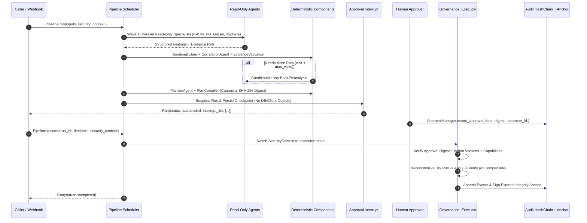

# HeuristicSyndicate — Technical Walkthrough

This guide walks through how `heuristic_syndicate` designs, executes, suspends, recovers, and audits a governed multi-agent workflow from start to finish.

---

## 1. Mental Model: The Governed Agent Architecture

Most agent frameworks give LLMs direct access to both read and write tools inside an autonomous loop. In operational environments (such as IT infrastructure, financial systems, or customer operations), that creates two severe risks:
1. **Prompt Injection & Uncontrolled Side Effects:** Untrusted log lines, commit messages, or database rows can trick an LLM into calling state-mutating tools.
2. **Uncertain Crash Recovery:** If a process crashes mid-loop after an external API call succeeds, restarting the chat loop blindly repeats the side effect.

`heuristic_syndicate` solves both problems by splitting every workflow into two distinct phases coordinated by a durable graph pipeline:



---

## 2. Step-by-Step Code Walkthrough

### Step 1: Establish the Immutable `SecurityContext` and `CredentialResolver`

Every operation in `heuristic_syndicate` requires an explicit, immutable [`SecurityContext`](../lib/heuristic_syndicate/security/security_context.rb) bound to a `tenant_id` and `actor_id` ([ADR-004](./architecture_decision_record.md#adr-004-capability-based-security-statt-einfacher-tool-kategorien), [ADR-005](./architecture_decision_record.md#adr-005-multi-tenancy-wird-ein-kernbestandteil)).

Credentials and client connections are never stored in checkpoints or passed through prompts. Instead, they are registered in a [`CredentialResolver`](../lib/heuristic_syndicate/security/credential_resolver.rb) that enforces `:read` vs. `:write` execution modes:

```ruby
resolver = HeuristicSyndicate::Security::CredentialResolver.new

# Read-only clients: available during :analysis mode
resolver.register(:pg_reader, mode: :read) { |_ctx| PostgresReadOnlyClient.new }

# Write clients: restricted exclusively to :executor mode (raises CapabilityDeniedError in :analysis mode)
resolver.register(:pg_writer, mode: :write) { |_ctx| PostgresAdminClient.new }

security_context = HeuristicSyndicate::SecurityContext.new(
  tenant_id: "werkbank_prod",
  actor_id: "alertmanager_webhook",
  capabilities: [
    { name: :postgres_read, resources: ["production.*"] },
    { name: :postgres_terminate, resources: ["production.postgres"] }
  ],
  environment: :production,
  policy_version: "1.0",
  execution_mode: :analysis # Agents always run in :analysis mode
)
```

---

### Step 2: Define Capability-Scoped Tools with `UntrustedData` Wrapping

Tools inherit from [`HeuristicSyndicate::Tool`](../lib/heuristic_syndicate/definitions/tool.rb). Each tool must declare:
- Access mode (`read_only` or `writes`)
- Required capability (`requires_capability`)
- Optional `scope` tag and `inject` dependencies
- `untrusted_output` classification ([ADR-004](./architecture_decision_record.md#prompt-injection))

```ruby
class PostgresLocksTool < HeuristicSyndicate::Tool
  description "Inspect PostgreSQL blocking locks and active sessions"
  read_only
  requires_capability :postgres_read
  scope "postgres"
  inject :pg_reader

  # Classifies output as untrusted external data, redacts leaked secrets/tokens,
  # truncates to 4,000 bytes, and attaches a provenance evidence_ref.
  untrusted_output
  max_output 4_000

  def execute(incident_id:)
    pg_reader.blocking_locks(incident_id)
  end
end
```

**How Tool Execution is Isolated from `RubyLLM`:**
When an agent is configured with `PostgresLocksTool`, [`Tool.to_ruby_llm_descriptor`](../lib/heuristic_syndicate/definitions/tool.rb#L112-L137) generates a schema-only `RubyLLM::Tool` subclass so `RubyLLM::Chat` can advertise the JSON parameter schema to the model provider. Its `#execute` method raises `HeuristicSyndicate::SecurityError`. Actual tool execution is performed exclusively by [`AgentRuntime`](../lib/heuristic_syndicate/runtime/agent_runtime.rb) after passing all four authorization checks in [`Security::Authorizer`](../lib/heuristic_syndicate/security/authorizer.rb).

---

### Step 3: Define Declarative Agents (`ADR-001`)

[`HeuristicSyndicate::Agent`](../lib/heuristic_syndicate/definitions/agent.rb) uses composition rather than inheriting from `RubyLLM::Agent`. When `tools` are declared on the class, `Security::Authorizer.authorize_agent_tool!` immediately verifies that the agent's `permits`, `capabilities`, and `scope` match every tool:

```ruby
class PostgresAgent < HeuristicSyndicate::Agent
  goal "Analyze PostgreSQL locks and connections for incident"
  model "werkbank-postgres"

  permits :read
  scope "postgres"

  capabilities do
    allow :postgres_read, resources: ["production.*"]
  end

  tools PostgresLocksTool
  outputs :postgres_analysis
  stops_when max_turns: 4
end
```

When `PostgresAgent` runs inside [`AgentRuntime`](../lib/heuristic_syndicate/runtime/agent_runtime.rb):
1. [`RubyLLMAdapter#execute`](../lib/heuristic_syndicate/llm/ruby_llm_adapter.rb#L82-L88) stages the prompt with `chat.ask_later` and calls `chat.generate` for a single model turn.
2. [`BudgetManager`](../lib/heuristic_syndicate/runtime/budget_manager.rb) records model request counts, token usage, and estimated cost against [`ExecutionPolicy`](../lib/heuristic_syndicate/runtime/budget_manager.rb#L6-L31).
3. If the model requests tool calls, `AgentRuntime` verifies capabilities, resolves injected dependencies from `CredentialResolver`, executes the tool, and records the result via `RubyLLMAdapter#record_tool_result`.
4. If a tool requires human approval (`requires_approval true`), `AgentRuntime` saves a JSON-safe [`ConversationCheckpoint`](../lib/heuristic_syndicate/llm/conversation_checkpoint.rb) and returns `{ status: :interrupted, reason: :tool_approval_required }`.

---

### Step 4: Deterministic Components & Evidence Validation

Tasks that require sorting, arithmetic, cryptographic hashing, or strict reference validation are implemented as [`HeuristicSyndicate::Component`](../lib/heuristic_syndicate/definitions/component.rb) subclasses—never delegated to an LLM:

```ruby
class EvidenceValidationComponent < HeuristicSyndicate::Component
  input :findings, type: Hash
  input :known_evidence_refs, type: Array

  output :validated_findings, type: Hash
  output :needs_more_data, type: Object

  def call(findings:, known_evidence_refs:, **_rest)
    # Reject any LLM hypothesis that cites fabricated or unknown evidence_refs
    hypotheses = Array(findings[:hypotheses]).select do |h|
      refs = Array(h[:evidence_refs])
      refs.any? && (refs - known_evidence_refs).empty?
    end

    if hypotheses.empty? && !findings[:needs_more_data]
      raise HeuristicSyndicate::ValidationError,
            "All root-cause hypotheses were rejected due to missing or fabricated evidence_refs"
    end

    {
      validated_findings: findings.merge(hypotheses: hypotheses),
      needs_more_data: findings[:needs_more_data] == true
    }
  end
end
```

---

### Step 5: Assemble the Pipeline Graph with Parallel Waves, Loops & Middleware

[`HeuristicSyndicate::Pipeline`](../lib/heuristic_syndicate/definitions/pipeline.rb) wires agents, components, and interrupts into a validated directed graph:

```ruby
class IncidentPipeline < HeuristicSyndicate::Pipeline
  # Entry nodes with no incoming forward edges run concurrently in Wave 1
  node :kasm, KasmAgent, max_visits: 2
  node :postgres, PostgresAgent, max_visits: 2
  node :gitlab, GitlabAgent, max_visits: 2
  node :vsphere, VsphereAgent, max_visits: 2

  node :timeline, TimelineBuilder, max_visits: 2
  node :correlation, CorrelationAgent, max_visits: 2
  node :evidence_check, EvidenceValidationComponent, max_visits: 2

  node :planner, PlannerAgent
  node :plan_compiler, PlanCompilerComponent
  node :approval, HeuristicSyndicate::Interrupt, type: :approval
  node :executor, IncidentExecutorComponent
  node :report, ReportAgent

  # Fan-in from the 4 parallel specialists into TimelineBuilder
  connect "kasm.kasm_analysis", "timeline.kasm"
  connect "postgres.postgres_analysis", "timeline.postgres"
  connect "gitlab.gitlab_analysis", "timeline.gitlab"
  connect "vsphere.vsphere_analysis", "timeline.vsphere"

  connect "timeline.timeline", "correlation.events"
  connect "correlation.correlation_findings", "evidence_check.findings"
  connect "timeline.known_evidence_refs", "evidence_check.known_evidence_refs"

  # Conditional loop-back edge (automatically marked loop_back: true)
  connect "evidence_check.needs_more_data", "postgres.reanalyze",
          condition: ->(out) { out[:needs_more_data] == true }

  # Forward continuation when evidence is sufficient
  connect "evidence_check.validated_findings", "planner.findings",
          condition: ->(out) { out[:needs_more_data] == false }

  connect "planner.raw_plan", "plan_compiler.raw_plan"
  connect "plan_compiler.plan", "approval.resource"
  connect "plan_compiler.plan", "executor.plan"
  connect "approval.decision", "executor.decision"
  connect "executor.execution_result", "report.execution_result"

  validate!
end
```

Every node execution passes through the [`Middleware::Stack`](../lib/heuristic_syndicate/middleware/stack.rb) ([ADR-011](./architecture_decision_record.md#adr-011-middleware-bleibt-auf-pipeline-nodes-begrenzt)):
`Instrumentation` → `Security` → `Audit` → `Budget` → `Timeout` → `Retry` (only on idempotent targets) → `Cache` (tenant- and policy-scoped) → `Guardrail` → `Node.call`.

---

### Step 6: Durable Node Execution, Fencing Tokens & Crash Reconciliation (`ADR-002`)

When a node is scheduled, [`NodeExecutor`](../lib/heuristic_syndicate/runtime/node_executor.rb) manages its lifecycle in the [`Store`](../lib/heuristic_syndicate/store/memory.rb):

1. **Atomic Claim & Fencing Token Increment:**
   `store.claim_node_execution` checks `NodeExecution#claimable?` (status is `:pending` / `:retry_scheduled`, or status is `:claimed` / `:running` with an expired [`ExecutionLease`](../lib/heuristic_syndicate/execution/execution_lease.rb)). It atomically increments `fencing_token` (`token + 1`) and assigns `lease.owner` and `lease.expires_at`.
2. **Stale Worker Rejection:**
   Every write (`store.transition_node_execution!`) compares the caller's `fencing_token` with the persisted token. If a slow worker wakes up after its lease expired and another worker claimed the node, its write is rejected with [`LeaseLostError`](../lib/heuristic_syndicate/errors.rb).
3. **Side-Effect Recovery (`:reconcile` vs `:idempotent` vs `:non_retryable`):**
   Before invoking an [`Action`](../lib/heuristic_syndicate/definitions/action.rb), `NodeExecutor` transitions the record with `side_effect_recorded: true`. If the worker process crashes (`SIGKILL` / `exit!(137)`) after the external side effect succeeds but before committing the output:
   - The recovery worker sees `attempt > 1 && side_effect_recorded == true`.
   - For `recovery_strategy :reconcile`, it calls `action.reconcile(context, params, idempotency_key:)` to query external state and reconstruct the output **without re-running `apply`**.
   - For `recovery_strategy :non_retryable` or `:manual_review`, it transitions the node to `:uncertain_outcome` rather than risking a duplicate side effect.

---

### Step 7: Versioned Action Contracts, Plan Digests & Durable Approval Interrupts (`ADR-006`)

1. **Plan Compilation & Canonical Digest:**
   [`Governance::Plan`](../lib/heuristic_syndicate/governance/plan.rb) validates every proposed step against [`ActionRegistry`](../lib/heuristic_syndicate/governance/action_registry.rb) (checking action allowlist membership, version, and parameter types). [`Governance::Digest.compute`](../lib/heuristic_syndicate/governance/plan.rb#L12-L40) computes a SHA-256 hash over canonical JSON containing the plan ID, tenant ID, steps, action names, action versions, parameters, target environment, resource identities, policy version, constraints, and expiration timestamp.
2. **Suspending at the Interrupt Node:**
   When `IncidentPipeline` reaches `node :approval, HeuristicSyndicate::Interrupt`, it persists an [`Interrupt`](../lib/heuristic_syndicate/interrupts/interrupt.rb) and a [`Checkpoint`](../lib/heuristic_syndicate/execution/checkpoint.rb) (which refuses to serialize any key matching `secret|password|api_key|token|credential|client` or any non-primitive Ruby object) and returns a `:suspended` [`Run`](../lib/heuristic_syndicate/execution/run.rb).
3. **Recording Human Approval:**
   [`ApprovalManager#record_approval`](../lib/heuristic_syndicate/governance/approval.rb#L45-L89) verifies that the administrator's approval matches `plan.digest` and has not expired. Duplicate approvals from the same approver are idempotent, and `ApprovalPolicy` enforces distinct approver counts by risk level (e.g., four-eyes principle for `:high` and `:critical` plans).

---

### Step 8: Deterministic Execution & Tamper-Evident Audit Anchoring (`ADR-006`, `ADR-007`)

When `IncidentPipeline.resume` is called:
1. `IncidentExecutorComponent` creates an `:executor`-mode `SecurityContext` (`security_context.with_execution_mode(:executor)`) and invokes [`Governance::Executor#execute!`](../lib/heuristic_syndicate/governance/executor.rb#L24-L124).
2. `Governance::Executor` verifies:
   - Tenant, environment, and policy version match the plan.
   - `ApprovalManager#verify_authorized!` confirms sufficient non-expired approvals for `plan.digest` **and** checks that no `Action` version in `ActionRegistry` has drifted since approval.
   - For each step: `Security::Authorizer.authorize_action!` → `action.precondition` → `action.dry_run` → `action.apply` (with `idempotency_key`) → `action.verify`.
   - If any step's `apply` or `verify` fails, `Governance::Executor` iterates through already-applied steps in reverse order, invoking `action.compensate` (or `rollback`) and recording `action.compensated` audit events.
3. [`Audit::HashChain`](../lib/heuristic_syndicate/audit/hash_chain.rb) links every [`Audit::Event`](../lib/heuristic_syndicate/audit/event.rb) via `previous_hash` and `payload_digest`. At completion, `audit_chain.create_anchor!` writes an HMAC-SHA256 signed [`Audit::Checkpoint`](../lib/heuristic_syndicate/audit/checkpoint.rb) to the write-once `AnchorStore`. [`Audit::Verifier.verify!`](../lib/heuristic_syndicate/audit/hash_chain.rb#L68-L124) detects any payload mutation, sequence gap, deletion, or database chain rewrite.

---

## 3. Running & Inspecting the Walkthrough Locally

Run the full test suite:

```bash
bundle exec rake test
```

Run an individual walkthrough test file:

```bash
# Run the complete Werkbank incident workflow & evidence loop tests
ruby -Ilib:test test/werkbank_workflow_test.rb

# Run the Spike 1 RubyLLMAdapter & cross-process restore tests (LLM-01..12)
ruby -Ilib:test test/spike_1_adapter_test.rb

# Run the Spike 2 Crash Recovery & concurrency tests (REC-01..12)
ruby -Ilib:test test/spike_2_recovery_test.rb

# Run the integrated Multi-Process Conversation + Tool Crash Recovery test
ruby -Ilib:test test/end_to_end_recovery_test.rb
```

You can also inspect the pipeline graph as a Mermaid diagram at any time:

```ruby
require_relative "examples/werkbank/incident_workflow"
puts Werkbank::IncidentPipeline.to_mermaid
```

---

## 4. Haystack 3.x to `HeuristicSyndicate` Mapping

| Haystack 3.x Concept | `HeuristicSyndicate` Equivalent | Key Difference / Enhancement |
| :--- | :--- | :--- |
| `Pipeline` (`add_component`, `connect`) | [`HeuristicSyndicate::Pipeline`](../lib/heuristic_syndicate/definitions/pipeline.rb) (`node`, `connect`) | Class-level declarative DSL with boot-time `validate!`, bounded parallel waves, and durable checkpoints. |
| `@component` + `run()` | [`HeuristicSyndicate::Component`](../lib/heuristic_syndicate/definitions/component.rb) (`input`, `output`, `call`) | Supports dependency injection (`inject`) from tenant-scoped `CredentialResolver`. |
| `ConditionalRouter` | `connect "a.out", "b.in", condition: ->(out) { ... }` | Native Ruby predicates on edges, plus automatic `loop_back` detection and `max_visits` guards. |
| `BranchJoiner` | Multiple `connect` edges into a target node | Target node executes automatically once all required forward input sockets are populated. |
| `Agent` (with internal tool loop) | [`HeuristicSyndicate::Agent`](../lib/heuristic_syndicate/definitions/agent.rb) + [`AgentRuntime`](../lib/heuristic_syndicate/runtime/agent_runtime.rb) | Decoupled from provider internals via `LLM::Adapter`; enforces 4-layer capabilities and `UntrustedData` wrapping before tools run. |
| `Tool` | [`HeuristicSyndicate::Tool`](../lib/heuristic_syndicate/definitions/tool.rb) | Explicit `read_only` / `writes`, `requires_capability`, `scope`, and `untrusted_output` secret redaction. |
| `Breakpoint` / `AgentBreakpoint` | [`Interrupt`](../lib/heuristic_syndicate/interrupts/interrupt.rb) + [`Checkpoint`](../lib/heuristic_syndicate/execution/checkpoint.rb) + [`ConversationCheckpoint`](../lib/heuristic_syndicate/llm/conversation_checkpoint.rb) | First-class production HITL approval & recovery primitives, separated between pipeline state and conversation state. |
| `DocumentStore` / `Retriever` | [`Memory::KnowledgeStore`](../lib/heuristic_syndicate/memory/stores.rb#L69-L155) | Enforces mandatory `tenant_id` filtering prior to keyword or vector similarity scoring. |
