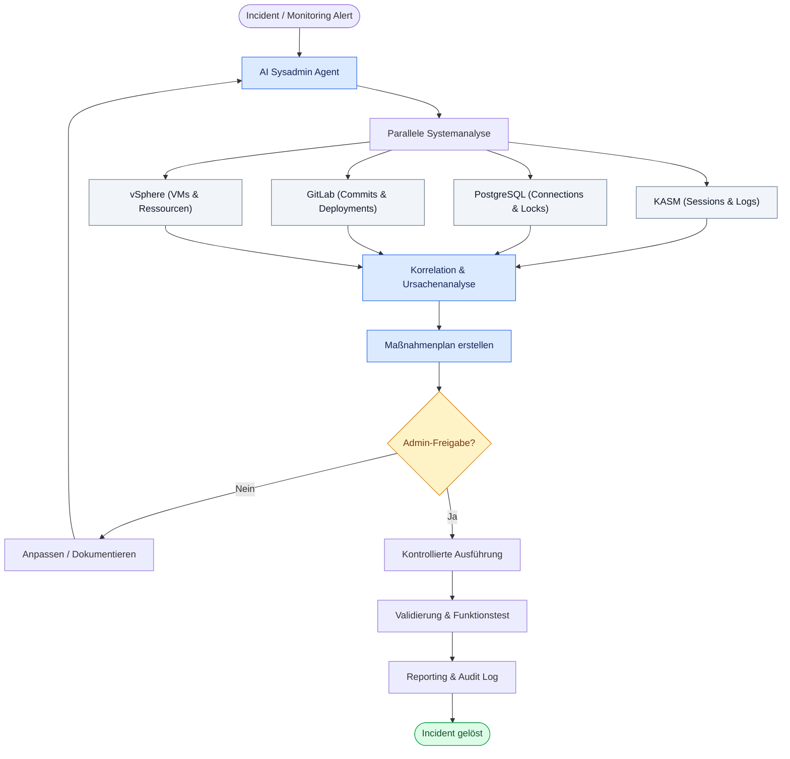

# Use case AI SYSADMIN AGENT

## Intelligente Automatisierung für Netzwerk- und IT-Infrastruktur

**Von der Störungsmeldung zur kontrollierten Problemlösung – systemübergreifend, intelligent und nachvollziehbar.**

### Zielsetzung

Ein AI-Agent unterstützt Systemadministratoren bei der Überwachung, Fehleranalyse und Administration einer IT-Infrastruktur. Er verbindet unterschiedliche Systeme, erkennt Zusammenhänge, erstellt Lösungsvorschläge und führt freigegebene Maßnahmen automatisiert aus.

### Integrierte Infrastruktur

| System             | Aufgaben des AI-Agenten                              |
| ------------------ | ---------------------------------------------------- |
| **KASM**           | Workspace-Status, Sessions und Logs analysieren      |
| **PostgreSQL**     | Datenbankverbindungen, Locks und Performance prüfen  |
| **GitLab**         | Konfigurationen, Commits und Deployments analysieren |
| **VMware vSphere** | VM-Status, CPU, RAM und Storage überwachen           |

### Workflow: Vom Incident zur Lösung

**1. TRIGGER** – Administrator meldet ein Problem oder Monitoring erkennt eine Störung.

**2. ANALYSE** – Agent untersucht KASM, PostgreSQL, GitLab und vSphere parallel.

**3. KORRELATION** – Agent verbindet Logs, Metriken und Änderungen und identifiziert die wahrscheinliche Ursache.

**4. LÖSUNG** – Agent erstellt einen Maßnahmenplan inklusive Konfigurationsänderung, Rollback und Teststrategie.

**5. FREIGABE** – Administrator prüft und genehmigt die geplanten Änderungen.

**6. EXECUTION & VALIDATION** – Agent führt freigegebene Aktionen aus und überprüft das Ergebnis.

**7. REPORTING** – Ergebnisse, Ursachen, Maßnahmen und Audit-Informationen werden dokumentiert.

### Architekturprinzip

- **AI Orchestration:** Planung und Steuerung der Aufgaben
- **API Integration:** Verbindung zu KASM, PostgreSQL, GitLab und vSphere
- **Security & Governance:** RBAC, Least Privilege, Freigabemechanismen und Audit-Logs
- **Human in the Loop:** Kritische Änderungen nur nach administrativer Genehmigung

### Business Mehrwert

- Schnellere Fehleranalyse und kürzere Reaktionszeiten
- Weniger manuelle Routineaufgaben
- Systemübergreifende Ursachenanalyse
- Standardisierte und reproduzierbare Betriebsprozesse
- Kontrollierte Automatisierung mit vollständiger Nachvollziehbarkeit

**VISION: Vom reaktiven Systemadministrator zum proaktiven, AI-gestützten IT Operations Management.**

### Workflow-Diagramm

